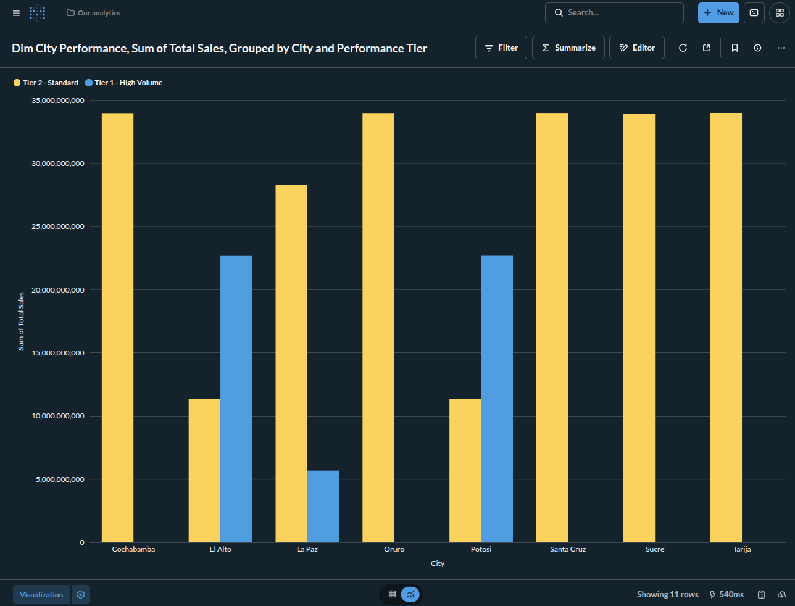
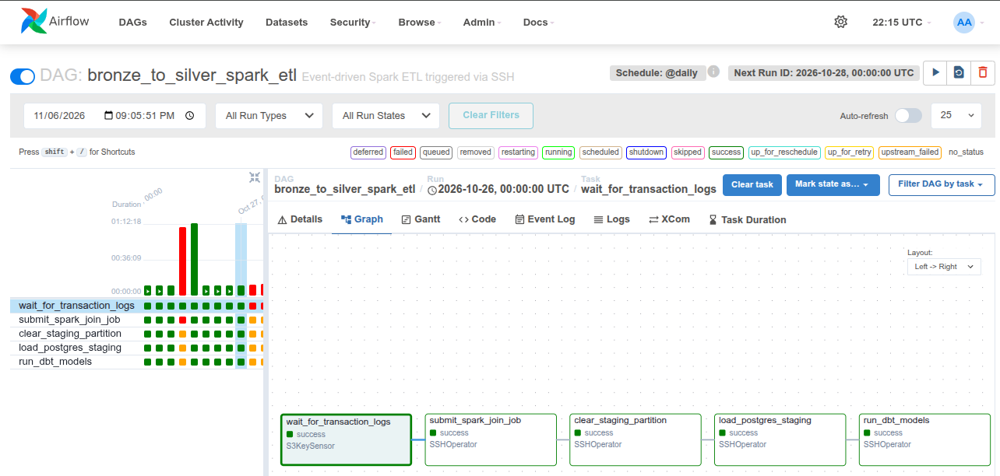
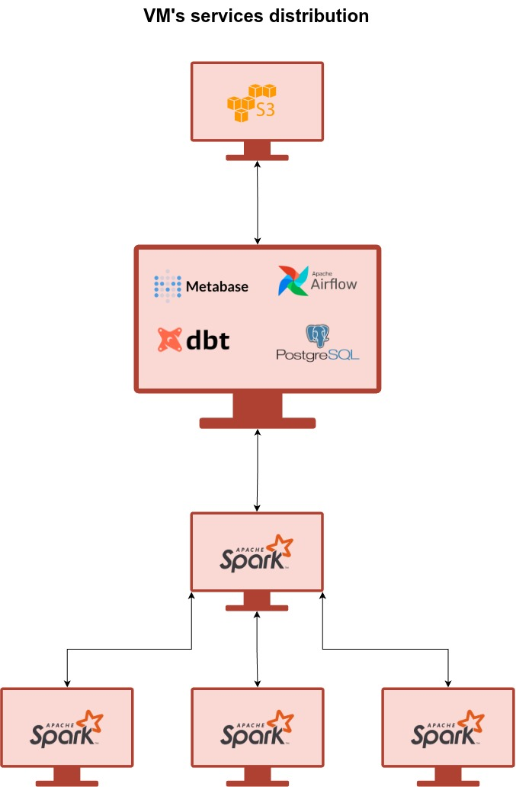
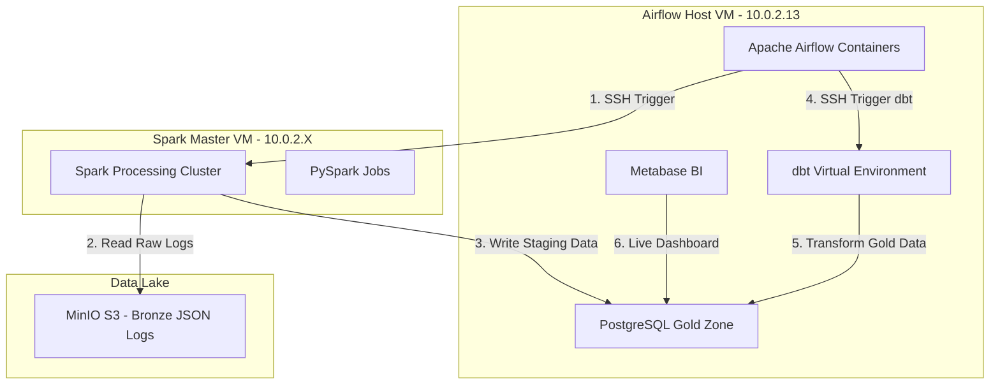

# E-Commerce Data Pipeline: Bronze to Gold ETL

## Project Overview
This project is an automated, batch-oriented ETL pipeline that processes daily e-commerce transaction logs. It extracts JSON data from an S3-compatible Data Lake (MinIO), processes it using a distributed Apache Spark cluster, and loads it into a PostgreSQL Data Warehouse. Final business aggregations are handled via dbt (Data Build Tool), with the entire workflow orchestrated by Apache Airflow and visualized in Metabase.

## Repository Structure
```text
├── dags/
│   └── bronze_to_silver_spark_etl.py     # Airflow DAG definition
├── spark_jobs/
│   ├── spark_total_by_city_workers.py    # Bronze to Silver PySpark script
│   └── spark_silver_to_gold.py           # Silver to Gold PySpark script
├── dbt_project/
│   ├── models/                           # dbt SQL models
│   ├── dbt_project.yml                   # dbt configuration
│   └── profiles.yml.example              # Template for DB credentials
├── infrastructure/
│   └── docker-compose.yml                # Docker configs for Postgres (and Metabase)
├── requirements.txt
└── README.md
```

## Pipeline Results & Orchestration

### Metabase dashboard



### Airflow DAG


## Architecture & Tech Stack
* **Orchestration:** Apache Airflow (Scheduled daily batch with `reschedule` sensors for memory efficiency)
* **Data Lake (Bronze):** MinIO (S3-compatible local storage)
* **Data Processing (Silver):** Apache Spark (PySpark)
* **Data Warehouse (Gold):** PostgreSQL (Hosted via Docker)
* **Transformations (Gold):** dbt
* **Business Intelligence:** Metabase

## Virtual Machines Services Distribution
* VM 1: MinIO S3 with RustFS
* VM 2: Airflow, Metabase, DBT and PostgreSQL
* VM 3: Spark Master Node
* VM 4: Spark Worker 1
* VM 5: Spark Worker 2
* VM 6: Spark Worker 3



## Infrastructure Topology & Deployment Map
Because this pipeline separates orchestration from compute, the repository files are deployed across two distinct Virtual Machines. Airflow remotely triggers the Spark cluster via SSH to ensure the orchestrator is never burdened with heavy data processing.



### Repository to VM Mapping
| Repository Folder | Destination Machine | Purpose |
| :--- | :--- | :--- |
| `dags/` | **Airflow VM** (`/opt/airflow/dags`) | Holds the DAG that monitors S3 and orchestrates the remote SSH commands. |
| `infrastructure/` | **Airflow VM** (`/home/airflow/`) | Docker Compose files to spin up the Airflow engine, PostgreSQL, and Metabase. |
| `dbt_project/` | **Airflow VM** (`/home/airflow/`) | Holds the SQL models. Airflow runs these against the Postgres database. |
| `spark_jobs/` | **Spark Master VM** (`/home/sparkuser/`) | The actual PySpark payload scripts that Airflow remotely executes via `spark-submit`. |

## How to Recreate This Environment

### 1. Infrastructure (Data Warehouse & BI)
Spin up the Gold zone database and Metabase on the Airflow host machine:
```bash
cd infrastructure/data_warehouse
docker-compose up -d
```
*(Note: The `init.sql` file will automatically provision the Postgres schemas and users on the first run).*

### 2. Configure Airflow
Copy `dags/bronze_to_silver_spark_etl.py` to your Airflow `dags/` folder. Before unpausing the DAG, create the following connections in the Airflow UI (Admin -> Connections):

1. **`rustfs_s3_conn`** (Type: Amazon Web Services)
   * Extra: `{"endpoint_url": "http://10.0.2.10:9000", "aws_access_key_id": "...", "aws_secret_access_key": "..."}`
2. **`spark_master_ssh`** (Type: SSH)
   * Host: `10.0.2.X` (Your Spark VM IP)
   * Username: `sparkuser`
   * Password/Key: `[Your SSH Key]`
3. **`airflow_host_ssh`** (Type: SSH)
   * Host: `10.0.2.13`
   * Username: `airflow`

### 3. Deploy Spark Jobs
Copy the contents of the `spark_jobs/` directory into `/home/sparkuser/` on your Spark Master VM. Create a real `.env` file based on `.env.example` to hold your MinIO access keys securely.

### 4. Deploy dbt
Copy the `dbt_project/` folder to `/home/airflow/airflow/gold_models` on the Airflow VM. Create your local `~/.dbt/profiles.yml` using `profiles.yml.example` as a template and insert your actual Postgres credentials.

## Pipeline Execution
The pipeline is designed to run completely hands-off.
1. The Airflow DAG triggers daily at midnight.
2. The `wait_for_transaction_logs` S3KeySensor polls MinIO using `mode='reschedule'` to preserve worker memory.
3. Once the daily log is detected, the sensor triggers the Spark cluster via SSH to process the JSON into the Silver zone, and then into the Gold PostgreSQL staging table.
4. Airflow executes `dbt run` and `dbt test` to build the final reporting models.
5. The processed data is immediately available for visualization in the Metabase dashboard.
